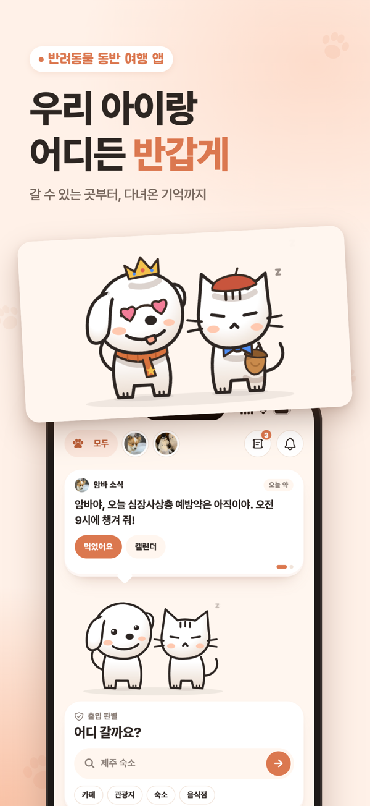
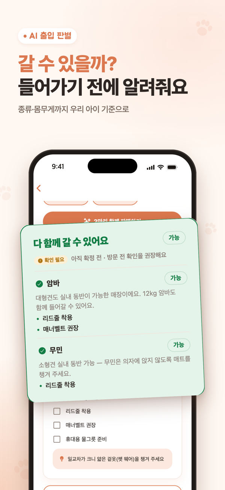
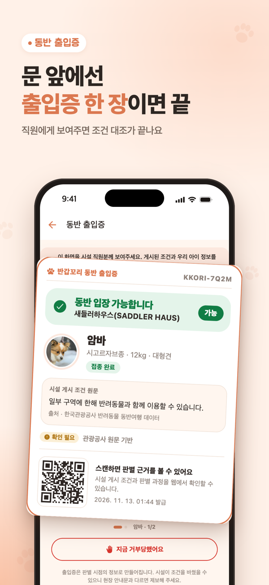
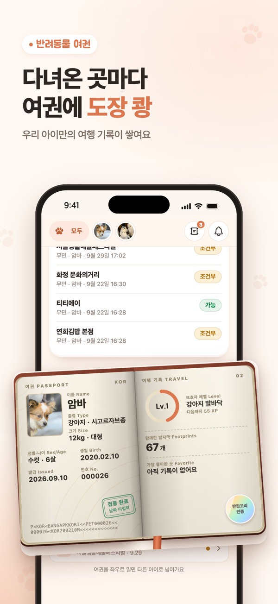
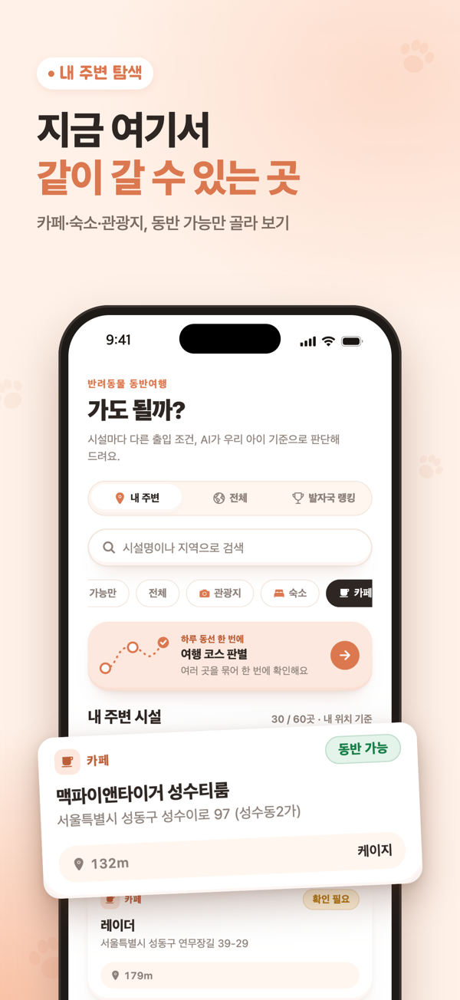
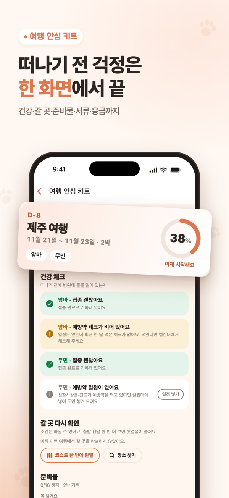

# 반갑꼬리

**우리 아이의 몸무게와 품종으로 시설 출입 조건을 판별해 주는 반려동물 동반여행 앱**

2026 관광데이터 활용 공모전 출품작

[**App Store**](https://apps.apple.com/kr/app/%EB%B0%98%EA%B0%91%EA%BC%AC%EB%A6%AC/id6810158091) · [포트폴리오 사례 기록](https://13jvv.github.io/projects/pet/)

 

| 첫 화면 | AI 출입 판별 | 동반 출입증 |
|:---:|:---:|:---:|
|  |  |  |
| **여행 여권** | **탐색** | **여행 안심 키트** |
|  |  |  |

> 이 저장소는 서비스 소개용입니다. 앱 소스 코드는 비공개로 관리하며, 앱은 App Store에서 내려받을 수 있습니다.

## 한눈에 보기

| 항목 | 내용 |
|---|---|
| 기간 | 2026.07 ~ |
| 형태 | 3인 팀 프로젝트 (본인 + 백엔드 2명) |
| 내 역할 | **프론트엔드 · 기능과 DB 설계 · 배포** |
| 출시 | App Store (iOS) |
| 규모 | 한국관광공사 시설 데이터 48,786건 분석 · 화면 26개 · 라이브 API 44개 중 43개 연동 |

## 문제

"반려동물 동반 가능"이라고 적혀 있어도 막상 가면 다릅니다. 10kg까지만, 소형견만, 실외 좌석만처럼 조건이 시설마다 다르고 어디에도 정리돼 있지 않습니다.

한국관광공사 반려동물 동반여행 데이터 48,786건을 분류해 보니, 조건을 규칙으로 읽을 수 있는 시설은 626건(1.3%)뿐이었고 대부분은 조건이 아예 적혀 있지 않았습니다.

## 해결

이 앱의 핵심은 지도가 아니라 **판별**입니다.

1. 시설이 게시한 조건 문장을 규칙으로 바꿉니다.
2. 등록한 반려동물의 몸무게 · 품종과 대조합니다.
3. **가능 / 조건부 / 어려움**을 근거 원문과 함께 보여 줍니다.

조건이 없거나 모호한 시설은 "가능"으로 단정하지 않고 **확인 필요**로 표시합니다. 조건이 없는 97%의 시설을 "가능"으로 보여 주지 않는 것이 이 서비스의 설계 전제입니다.

## 주요 기능

| 기능 | 설명 |
|---|---|
| **AI 출입 판별** | 시설 조건 원문을 반려동물 정보와 대조해 여러 마리를 한 번에 판별하고, 필요한 준비물까지 알려 줍니다. |
| **동반 출입증** | 판별 결과와 시설 조건 원문, 반려동물 정보를 한 장에 담아 직원에게 보여 줄 수 있습니다. QR로 판별 근거를 확인합니다. |
| **여행 여권** | 방문한 시설에 도장을 남깁니다. 시설 반경 안에서 찍으면 "현장" 배지가 붙습니다. |
| **탐색** | 지역 · 지도 · 코스로 동반 가능한 시설을 찾습니다. |
| **여행 안심 키트** | 접종 · 예방약 · 갈 곳 · 준비물을 출발 전에 한 화면에서 점검합니다. |
| **제보** | 실제로 입장을 거부당했다면 제보해 다른 사용자에게 알립니다. |

## 기획과 개발에서 내린 결정

- **모르는 건 모른다고 보여 줬습니다.** 조건이 모호하거나 없는 시설은 "가능"이 아니라 "확인 필요"로 남겨, 앱이 실제보다 많이 안다고 말하지 않게 했습니다.
- **두 안을 직접 만들어 비교했습니다.** 시설 카드에 조건 정보를 얼마나 보여 줄지 팀원과 의견이 갈렸을 때, 두 화면을 모두 구현해 비교한 뒤 팀원의 안을 채택했습니다.
- **보내지 않은 것을 보냈다고 말하지 않았습니다.** 서버로 전송되지 않던 "확인 요청" 버튼의 문구를 실제 동작에 맞게 고치고, 제보는 서버 전송을 연결했습니다.
- **실제 시설 ID로 끝까지 확인했습니다.** 관광공사 실데이터로 화면과 API를 끝까지 연결해 보며 연결 오류를 고친 뒤 App Store에 공개했습니다.

## 기술 스택

| 구분 | 사용 기술 |
|---|---|
| App | Expo, React Native, TypeScript |
| AI | Claude API (구조화 출력으로 조건 판별 · 파싱) |
| Data | 한국관광공사 반려동물 동반여행 데이터, MySQL |
| Backend | Spring (팀원 2명 담당) |
| 배포 | EAS Build, App Store Connect, TestFlight |

 

제작 · 신재우 · <a href="https://13jvv.github.io/">포트폴리오</a>

